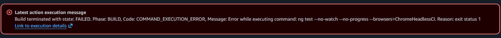
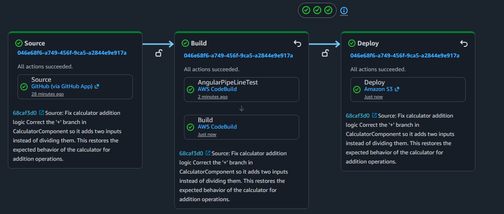

## 1. 🌐 AWS CodeBuild Website
Building and deploying an Angular application while gaining hands‑on experience with AWS CodeBuild and AWS CodePipeline to automate the build, test, and deployment process into an S3 bucket.

> [!NOTE]
> This documentation focuses on pipeline execution and validation results. The buildspec.yml and buildspec-test.yml files are not included in the repository.

## 2. 🎓 CodeBuild Learning Objectives
- Understand what CodeBuild is and its use with CodePipeline
- Provide build commands to CodeBuild with source code
- Check logs in case of build failures
- Use CodeBuild for automated test on he pipeline

## 3. 🕵🏽‍♂️ Pipeline Failure Analysis
### ⛔ Issue 1: 
- **Issue:** Unit tests could not run due to insufficient IAM permissions.
- **Root Cause:** Misconfigured principal ARN in `CodeBuild-CodePipeline`.
- **Analysis:** Reviewed logs, IAM policies, and used Amazon Q.
- **Fix:** Updated ARN to *AngularPipeLineTest*.

##  4. 🚦 Pipeline Diagnostics & Validation 
- With the pipeline permission errors resolved, I proceeded with application testing and encountered the following message after pushing a misconfigured script to the repository.

- After fixing the misconfigured script and pushing it to the repository, I received the following message confirming that all was well.

## 5. 🔬 Observations & Learning
- Misconfigured IAM policies or roles can lead to permission-related failures that prevent pipeline resources from performing required actions.
- Projects can use dedicated or shared buildspec files, enabling consistent and customizable build instructions across pipelines.
- Pipeline stage transitions can be disabled to pause execution while issues are investigated or changes are validated.
- Workflow artifacts stored in S3 provide a record of pipeline outputs and execution results.
- Build projects, build history, report groups, and report history offer visibility into build execution and outcomes.
- Build logs help identify status code errors and pinpoint where failures occur within the build lifecycle.
- Custom buildspec naming conventions help organize build configurations and distinguish build instructions across projects, environments, or pipeline stages.

## 6. 🔜 Exploring Next
- AWS CodeDeploy