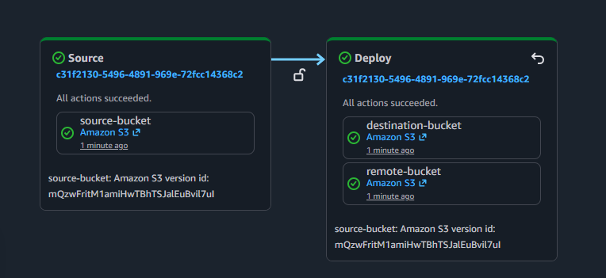
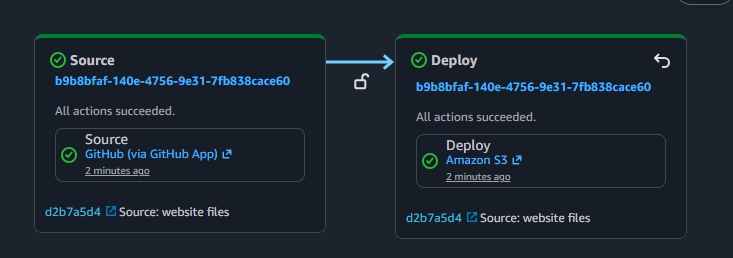

## 1. 🌐 CodePipeline Basics Website Exercises
This README introduces the basics of AWS CodePipeline, a fully managed continuous delivery (CD) service that helps automate release pipelines for fast and reliable application and infrastructure updates. It covers two CodePipeline deployments designed to demonstrate core concepts by creating custom two-stage pipelines using a versioned Amazon S3 bucket and GitHub as source repositories.
- **Pipeline 1:** Deploys a static website from a private S3 source bucket to both a public S3 bucket and a remote S3 bucket.
- **Pipeline 2:** Deploys the same static website from a GitHub repository to a public S3 bucket.

## 2. 📐 Pipeline Resources Utilized
| Service | Purpose |
|----------|----------|
| AWS CodePipeline | Automated the deployment workflow |
| Amazon S3 | Hosted source, destination and remote artifacts and static websites |
| AWS IAM | Managed service roles and permissions |
| Amazon CloudWatch | Monitored pipeline executions and logs |
| GitHub | Served as the source code repository for Pipeline 2 |

## 3. 🔄 Pipeline Workflow
### Pipeline 1: Amazon S3 to Amazon S3
1. Created and configured a versioned Amazon S3 source bucket.
2. Created public and remote destination S3 buckets.
3. Configured a two-stage AWS CodePipeline deployment workflow.
4. Created IAM service roles and assigned required permissions.
5. Uploaded website files to the source bucket to trigger deployments.
6. Verified successful artifact delivery to both destination buckets.

### Pipeline 2: GitHub to Amazon S3
1. Connected a GitHub repository as the pipeline source.
2. Configured AWS CodePipeline to monitor repository changes.
3. Created deployment actions targeting an Amazon S3 website bucket.
4. Validated automatic pipeline executions following GitHub commits.
5. Reviewed execution history and logs to confirm successful deployments.

## 4. 🎓 Knowledge and Skills Gained
### Pipeline Configuration
- Created, updated, and deleted AWS CodePipeline pipelines
- Built a custom two-stage pipeline using versioned Amazon S3 buckets
- Modified pipeline configurations and manually triggered pipeline executions 

### Source Integration
- Integrated GitHub as a source provider for AWS CodePipeline
- Configured Amazon S3 buckets as versioned source repositories
- Added a remote S3 bucket to trigger parallel pipeline updates

### IAM and Security
- Created and configured IAM service roles for AWS CodePipeline
- Attached IAM policies to grant least-privilege access to pipeline resources
- Managed permissions for Amazon S3 and GitHub integrations
- Verified role assumptions and service permissions during pipeline execution

### Monitoring and Validation
- Triggered pipeline executions through source code and object updates
- Reviewed execution history, stage details, and CloudWatch logs
- Troubleshot pipeline failures using logs and permission checks

### Cleanup
- Removed pipeline resources after completing the exercise

## 5. ✅ Deployment Results
### Pipeline 1 Results
- Successfully deployed a static website from a versioned Amazon S3 source bucket.
- Automated artifact delivery to both a public S3 website bucket and a remote destination bucket.
- Verified successful pipeline execution following updates to source objects.

### Pipeline 2 Results
- Successfully integrated GitHub as the source repository.
- Automated website deployments from GitHub commits to an Amazon S3 website bucket.
- Validated automatic pipeline triggers following source code changes.

### Validation
- Confirmed successful artifact transfers across all deployment stages.
- Verified deployment status through CodePipeline execution history.
- Monitored executions and logs using Amazon CloudWatch.

## 6. 🐞 Challenges and Troubleshooting
### IAM Permission Issues
Resolved service role permission errors by updating IAM policies and trust relationships.

### Pipeline Trigger Validation
Verified source bucket versioning and event configurations to ensure deployments were triggered correctly.

### Deployment Verification
Used CloudWatch logs and execution history to validate successful artifact transfers.

## 7. 👁️ Lessons Learned
This exercise strengthened my understanding of AWS continuous delivery services and demonstrated how CodePipeline can automate deployment workflows across multiple source providers. I gained experience integrating GitHub and Amazon S3, managing IAM permissions, monitoring pipeline executions, and troubleshooting deployment issues. Most importantly, I learned how automation, security, and observability work together to create reliable CI/CD pipelines.

## 8. 🔍 Exploring Next
- CodeBuild